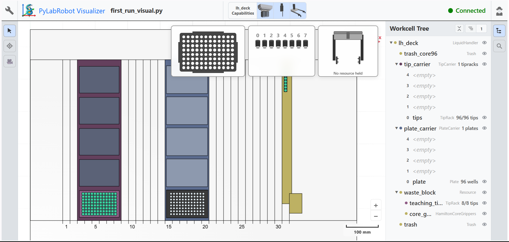

# PyLabRobot: first steps

I'm an automation engineer (PLC programming, robotics and commissioning of production lines) learning to control lab instruments with Python. This repo holds my first experiments with [PyLabRobot](https://github.com/PyLabRobot/pylabrobot), running in simulation without any hardware.



## What's inside

| File | What it does |
|---|---|
| `first_run.py` | Sets up a simulated Hamilton STARlet with a tip rack and a 96-well plate, then moves 100 µL from well A1 to A2. The Chatterbox backend prints every command the robot would execute. |
| `first_run_visual.py` | Same protocol, with the PyLabRobot Visualizer showing the deck in the browser step by step. |
| `fill_row.py` | My own variation: distributes 10 µL from A1 into wells A2 to A12 with a loop. |

## How to run

```
python -m venv venv
venv\Scripts\activate
pip install pylabrobot
python first_run.py
```

On Linux or macOS, activate with `source venv/bin/activate` instead.

Tested with PyLabRobot 0.2.2 and Python 3.12.

## What I noticed coming from PLCs

The backend is swappable. The same protocol runs on the simulator or on a real robot by changing one line, which is the same idea as testing PLC logic in simulation before commissioning a machine.

The deck, carriers, tip racks and plates are described as resources with exact positions, much like the hardware configuration of a machine in TwinCAT.

Every step is an async Python call, so a protocol can be coordinated with other devices. That's what turns separate instruments into a work cell.

## Next steps

Speed up `fill_row.py`: aspirate once and dispense into each well instead of making 11 round trips, the same way I would shorten a PLC sequence.

Track liquid volumes and handle errors such as a missing tip or an empty well.

Add a second simulated device and orchestrate both in one workflow.
